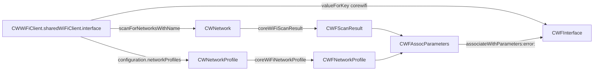

# macOS CoreWiFi join PoC

Proof of concept: join a **saved** Wi-Fi network on macOS through the private
`CoreWiFi` framework, using the password airportd already holds in the System
keychain. The calling process never reads or supplies the password.

Public CoreWLAN (`-[CWInterface associateToNetwork:password:error:]`) needs the
password in your process. This PoC shows the private path that does not.

> **Private API.** Undocumented, unsupported, observed on macOS 27.2.1 only.
> It can change or vanish in any macOS update. Do not ship it in App Store apps.
> A join can drop your current connection.

## Build and run

```sh
./build.sh                               # prints .build/corewifi-join
.build/corewifi-join authorize           # approve the Location prompt once
.build/corewifi-join list                # nearby networks + join eligibility
.build/corewifi-join inspect 'My SSID'   # dry run: builds params, no join
.build/corewifi-join join 'My SSID'      # real join
```

All output is JSON on stdout; progress goes to stderr. Exit codes: `0` ok,
`1` failure, `2` usage error.

`SIGNING_IDENTITY="Your Cert" ./build.sh` signs with a stable identity. The
default ad-hoc signature works, but macOS forgets the Location approval after
every rebuild.

### Why an `.app` and a launcher?

macOS redacts SSIDs (`ssid: null`) unless the process has Location permission.
Location permission is attributed per app bundle, and a binary exec'd from a
terminal inherits the terminal's attribution. `.build/corewifi-join` is a
shell launcher that starts the bundle through LaunchServices (`open -n -W`) so
it gets its own permission entry, then forwards stdout, stderr and exit code.

## How the API works

Everything goes through objects you can already reach from public CoreWLAN.



### 1. Load CoreWiFi and get its client

```objc
dlopen("/System/Library/PrivateFrameworks/CoreWiFi.framework/CoreWiFi", RTLD_NOW);
CWInterface *interface = [CWWiFiClient sharedWiFiClient].interface;
id corewifi = [interface valueForKey:@"corewifi"];   // private CWFInterface
// [corewifi serviceType] == 5 on the tested system; the PoC refuses anything else.
```

Reuse this already-configured connection. Do not `activate`/`invalidate` it.

### 2. Get the private scan result

```objc
NSSet<CWNetwork *> *scan = [interface scanForNetworksWithName:ssid error:&err];
id scanResult = [network coreWiFiScanResult];        // CWFScanResult
```

Useful private getters on it: `SSID` (raw bytes), `isPSK`, `scanRecord`.

### 3. Get the private saved profile

```objc
for (CWNetworkProfile *p in interface.configuration.networkProfiles)
    if ([p.ssidData isEqual:network.ssidData] && [network supportsSecurity:p.security])
        profile = [p coreWiFiNetworkProfile];         // CWFNetworkProfile
```

Getters: `SSID`, `isSystemMode`, `isPSK`. Match raw SSID bytes **and** security
type; the PoC refuses if more than one profile matches.

### 4. Build parameters and associate

```objc
id params = [[NSClassFromString(@"CWFAssocParameters") alloc] init];
[params setScanResult:scanResult];
[params setKnownNetworkProfile:profile];
[params setPassword:nil];                            // airportd uses the keychain
BOOL ok = [corewifi associateWithParameters:params error:&err];
```

`ok == YES` means airportd accepted the request. Check `interface.ssidData`
afterward for the actual association; neither proves internet access.

## Limits

- Saved networks only. The PoC never creates a profile.
- System-mode, personal (PSK) networks only. Enterprise (802.1X) is untested.
- If **Require administrator authorization to change networks** is on, macOS
  may show an auth prompt.
- No entitlements, no sudo.
- Each selector is checked with `respondsToSelector:` first; missing API fails
  with `UnavailablePrivateAPI` instead of crashing.

## Origin

Extracted from [OmniWM](https://github.com/OmniNull/OmniWM) research. GPL-2.0-only.
